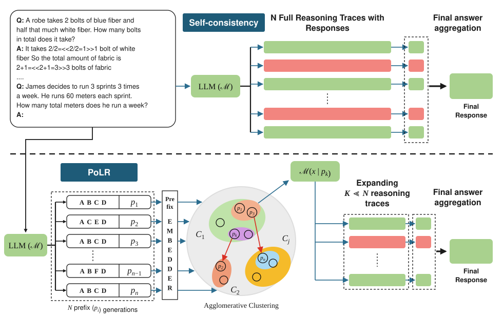

<h1 align="center">PoLR</h1>

<p align="center">
  <b>The Path of Least Resistance: Guiding LLM Reasoning Trajectories with Prefix Consensus</b>
</p>

<p align="center">
  <a href="https://arxiv.org/abs/2601.21494"></a>
  <a href="https://jayanttaneja.github.io/PoLR/"></a>
</p>

PoLR clusters short prefixes of reasoning traces, identifies the dominant cluster, and expands only a subset of promising paths, preserving the accuracy benefits of Self-Consistency (SC) while substantially reducing token usage and latency.

<p align="center">
  <picture>
    <source media="(prefers-color-scheme: dark)" srcset="assets/img/polr-overview-dark.svg">
    
  </picture>
</p>

## Results

Accuracy of Self-Consistency, PoLR's change in accuracy, and PoLR's token saving η, with N = 51 sampled traces per question.

| Model | | GSM8K | MATH500 | AIME24 | AIME25 | GPQA-Diamond |
|---|---|:---:|:---:|:---:|:---:|:---:|
| DeepSeek-R1-Distill-Qwen-7B | SC accuracy (%) | 79.8 | 89.8 | 53.3 | 33.3 | 57.1 |
| | PoLR − SC (pts) | +0.2 | −0.4 | −6.7 | 0.0 | −1.5 |
| | Fewer tokens, η (%) | 26.5 | 48.7 | 50.9 | 48.8 | 57.1 |
| QwQ-32B | SC accuracy (%) | 90.8 | 91.8 | 80.0 | 76.7 | 68.7 |
| | PoLR − SC (pts) | −0.3 | +0.2 | 0.0 | −10.0 | +1.5 |
| | Fewer tokens, η (%) | 47.6 | 51.8 | 59.7 | 56.8 | 53.8 |

From Table 2 of the paper, which also covers DeepSeek-R1-Distill-Qwen-1.5B, Phi-4-15B and MiMo-RL-7B, and N = 11 and 31.

## Citation

```bibtex
@inproceedings{ICLR2026_5a0ce3ab,
 author = {Jindal, Ishan and Akuthota, Sai Prashanth and Taneja, Jayant and SHARMA, SACHIN},
 booktitle = {International Conference on Learning Representations},
 editor = {C. Vondrick and B. Hariharan and C. Raffel and L. Pinto and D. Yang and A. Faust},
 pages = {54914--54934},
 title = {THE PATH OF LEAST RESISTANCE: GUIDING LLM REASONING TRAJECTORIES WITH PREFIX CONSENSUS},
 url = {https://proceedings.iclr.cc/paper_files/paper/2026/file/5a0ce3abb720b740419e193c87afd080-Paper-Conference.pdf},
 volume = {2026},
 year = {2026}
}
```
